# Hunter System: Database Design

**Stage:** 5, Database design and implementation
**Last updated:** 2026-10-14
**Schema version:** `2026.10.14-3` (`database/schema.sql`). Upgrade paths: `-1` → `-2` with `migrations/002_v2_simplify_and_approvals.sql`; `-2` → `-3` with `migrations/003_auth_throttle_readiness_badges.sql`.
**Status:** Implemented and verified. `hunter_system_dev` on XAMPP was migrated to `-2` and then to `-3` on 2026-10-14 and verified there (verify.sql 65/0/2). The API reaches it only as the restricted `hunter_app` account (`architecture.md` §6). Policy values are **approved**; badge prices and artwork remain provisional.

**Schema `-3` added three things for the authentication milestone:**
- the `login_throttle` table
- readiness counting only **valid** quiz questions
- badge price approval enforced: on sale only with an approved price, and a price change withdraws approval

Labels follow `database-requirements.md`: **CONFIRMED** (C-xx), **APPROVED** (A-xx, 2026-10-14; see `decisions.md`), **PROPOSED** (P-xx not yet decided), **OPEN**.

---

## 1. Scope

This covers the database only: tables, constraints, triggers, views, seed data, migration and verification. The PHP backend, API and React frontend are **not** built yet. `database/tests/transactions_check.php` is a CLI harness that exercises the designed transactions; it is not the backend. Architecture and API contracts are in `architecture.md` and `api-contract.md`.

## 2. Environment

| Item | Value |
|---|---|
| Project path | `C:\xampp\htdocs\hunter-system` |
| Database product | **MariaDB 10.4.32** (XAMPP), port 3306 |
| PHP | 8.2.12 CLI, `pdo_mysql`; Argon2id available; `intl` disabled in `php.ini` |
| Databases | `hunter_system_dev` (this design, `-2`), `hunter_system_verify` (throwaway test data, `-2`), `hunter_system` and `hunter_system_test` (pre-existing, untouched) |
| Character set | `utf8mb4` / `utf8mb4_unicode_ci`, InnoDB, UTC timestamps |

> **SQL dialect.** C-02 says "MySQL", but XAMPP provides MariaDB 10.4. The SQL uses MariaDB features: `BEGIN NOT ATOMIC`, `PERSISTENT` generated columns, `UTC_TIMESTAMP()` defaults and `CREATE OR REPLACE TRIGGER`.
>
> **Client flag.** Run SQL files with `mysql --abort-source-on-error ... -e "source file.sql"` (or `mysql ... < file.sql`). Without the flag the client keeps going after an error, which bypasses the guard blocks. This was found and fixed during the migration rehearsal.

## 3. Key design decisions

| # | Decision | Reason |
|---|---|---|
| D1 | **Complete per-attempt snapshots** keep history. Each assigned question copies its stem, code, explanation, topic and group tagging, and every choice **including the correct flag**. The question bank is edited in place; its `revision` counter is informational only. | One method. Grading and history read only the snapshot, so bank edits never change a past attempt (C-08). Tested (B15). |
| D2 | **One `attempts` table** for the assessment and quizzes, with a separate result table for each kind (`assessment_results`, `quiz_results`). | They share the same assign, snapshot, answer and finalize steps but have different result columns. |
| D3 | **`student_profiles` is each student's wallet and lock row.** It holds onboarding state, the permanent placement, the current Hunter rank and a cached coin balance. Every write for a student locks this row first. | Coins, attempts, answers and rank for one student run one at a time, with one lock order everywhere. |
| D4 | **Rules are versioned policy rows**: `quiz_grading_policies` with grade bands, `assessment_policies` with quotas and placement bands, `reward_policies`, `rank_progression_policies` with bands, and `app_policies`. Results and promotions record the version they used. Approving a value adds a new version; the provisional v1 rows remain as `retired`. | Rules can change without re-grading history. |
| D5 | **Only facts that can't be derived are stored.** Assessment group results and per-topic evidence are views over the immutable snapshot (S1). Per-topic quiz statistics (completed count, best score, first pass) are views over attempts and results (S2). | Removes copies PHP would have to keep in step, and the views can't disagree with the results. Approved 2026-10-14. |
| D6 | **33 triggers** enforce what foreign keys and CHECKs can't: finalize once, complete before finalizing, frozen snapshots, append-only history, a balance that never goes negative, cache equals ledger, rank changes only through history, **rank never decreases**, and promotion evidence. | A database backstop if PHP has a bug or two requests race. |
| D7 | **Composite foreign keys** carry ownership and amounts. A showcase row must point at the student's own ownership row. A ledger amount must equal the price paid or the reward. An answer must be a choice of the same assigned question. A promotion's rank must be a band of the policy it cites. | Rules spanning two rows become database guarantees. |
| D8 | **UTC everywhere**: `DATETIME(3)` columns with `UTC_TIMESTAMP(3)` defaults, and each session sets `time_zone='+00:00'`. | Only server time is trusted; the client converts for display. |
| D9 | **Nothing cascades and history is never deleted.** All foreign keys use `RESTRICT`; rows are retired or deactivated instead. | I-22. |
| D10 | **Login is by email only.** Students also have a separate `display_name`. Email is stored lower-case, enforced by a CHECK. | Approved 2026-10-14. |

## 4. Tables and responsibilities

35 tables, 8 views, 34 triggers. Columns, types, nullability, defaults, keys, CHECKs and triggers are in **Appendix A**, generated from the live schema.

| Area | Table | Responsibility |
|---|---|---|
| Marker | `schema_info` | Installed schema version. |
| Accounts | `users` | Email (login), display name, Argon2id password hash, role (student or admin), status. |
| Reference | `experience_levels`, `ranks`, `skill_groups` | The four self-selected levels; ranks E–S (E = Rookie); skill groups G1–G6. |
| Curriculum | `topics` | 18 topics in fixed order, with skill group and content status (`draft`, `available`, `retired`). |
| | `lessons` | One Markdown lesson per topic, with status and revision. |
| | `questions`, `question_choices` | Question bank (quiz or assessment use, status, revision); choices, at most one correct. |
| Policies | `quiz_grading_policies`, `quiz_grade_bands` | 5 questions, pass mark 3, A–F bands, and `min_pool_size` for topic readiness. |
| | `assessment_policies`, `assessment_group_quotas`, `placement_rank_bands` | 10 questions split 2/2/2/2/1/1, score → placement rank, starting-topic rule and fallback rule. |
| | `reward_policies` | First-completion reward amount. |
| | `rank_progression_policies`, `rank_progression_bands` | Topics passed → rank (0–2 E … 15–18 S). |
| | `app_policies` | Showcase limit 3, recently active 15 min, idle expiry 30 min, activity update every 60 s. |
| Student | `student_profiles` | Experience, onboarding, permanent placement, current Hunter rank, cached coins (the lock row). |
| Attempts | `attempts`, `attempt_questions`, `attempt_question_choices` | The attempt; each assigned question's snapshot plus the student's answer; the snapshot choices. |
| Results | `quiz_results`, `assessment_results` | Quiz grade and policy used; placement rank, recommended topic, **offered topic** and policy used. |
| Progress | `student_topic_progress` | When and how each topic was unlocked, plus lesson visits. Nothing else. |
| Ranks | `rank_history` | Append-only placement, promotion and correction rows, with evidence, policy version and topics passed. |
| Coins | `reward_claims`, `coin_ledger` | One claim per student, topic and reward type; append-only ledger with a running balance. |
| Badges | `badges`, `badge_ownership`, `badge_showcase` | Catalogue (`draft`, `on_sale`, `off_sale`, `retired`), ownership with the price paid, and the showcase. |
| Sign-in | `user_sessions`, `login_events` | Hashed session reference, activity and end; login outcomes. |
| | `login_throttle` | Login throttling. Stores only HMAC-keyed hashes of an email or IP, never raw values. Rows are deleted 24 hours after creation at the latest, or as soon as they're idle and unlocked. It's the only table PHP deletes from. |
| Admin | `audit_log` | Administrator change trail (content management was approved). |

**Views**

| View | Purpose |
|---|---|
| `v_attempt_choices_public` | Snapshot choices **without** the correct flag, for use before submission. |
| `v_topic_readiness` | `is_ready` = topic `available` + lesson published + at least `min_pool_size` (10) active **valid** quiz questions (2 or more choices, exactly one correct). |
| `v_assessment_group_results` | Asked and correct counts per skill group (derived, S1). |
| `v_assessment_topic_evidence` | Asked and correct counts for every topic, labelled `not_assessed` or `sampled` (derived, S1). |
| `v_student_topic_status` | Stored unlock and lesson facts, plus derived completed count, best score, first pass and display status (S2). |
| `v_student_topics_passed` | Distinct topics passed per student, for rank progression and admin progress. |
| `v_wallet_reconciliation` | Cached balance vs ledger sum vs last running balance. |
| `v_admin_student_overview` | The C-21 tracking list: last login, last activity, recently active, rank, current topic, topics passed out of 18. |

## 5. Relationship cardinalities

| Relationship | Cardinality | Enforced by |
|---|---|---|
| user → student profile | 1 : 0..1 (students only) | Primary key doubles as FK; composite FK `(user_id,'student')` → `users(id, role)` |
| skill group → topics | 1 : n | FK |
| topic → lesson | 1 : 0..1 | UNIQUE `lessons.topic_id` |
| topic → questions → choices | 1 : n : n | FKs; unique key allowing one correct choice |
| student → attempts | 1 : n; at most one in progress per topic, and one for the assessment | UNIQUE `(user_id, kind, topic_key, open_key)` |
| attempt → assigned questions | 1 : exactly 10 or 5 at finalization | CHECK, position trigger, finalization trigger |
| assigned question → snapshot choices | 1 : n | FK |
| attempt → result | 1 : 0..1 | Result primary key; composite FK that checks the attempt kind |
| student → placement | 1 : 0..1, permanent | UNIQUE, composite FKs, trigger |
| student × topic → progress row | One row per topic | Primary key `(user_id, topic_id)` |
| student → rank history | 1 : n; at most one placement row; promotions only upward | UNIQUE `(user_id, placement_key)`; triggers |
| promotion → policy band | n : 1 | Composite FK `(rank_policy_id, to_rank_id)` → bands |
| student × topic × reward type → claim | At most 1 | UNIQUE |
| claim or ownership → ledger entry | 1 : 1 | UNIQUE on the ledger's cause columns; PHP transaction; `verify.sql` A17 |
| student × badge → ownership | At most 1 | UNIQUE |
| ownership → showcase | 1 : 0..1, at most 3 per student | Composite FK; PHP enforces the limit |
| user → sessions | 1 : n | FK |
| session → login event | 1 : 0..1 | FK; UNIQUE `login_events.session_id` |

## 6. Entity-relationship diagram

```mermaid
erDiagram
    users ||--o| student_profiles : "is (students only)"
    users ||--o{ user_sessions : opens
    users |o--o{ login_events : "attempts (known only)"
    user_sessions |o--o| login_events : "started by"
    users ||--o{ audit_log : "admin writes"

    experience_levels |o--o{ student_profiles : chosen
    ranks |o--o{ student_profiles : "placement / current"
    skill_groups ||--|{ topics : groups
    topics ||--o| lessons : has
    topics ||--o{ questions : pools
    questions ||--|{ question_choices : offers

    student_profiles ||--o{ attempts : takes
    topics |o--o{ attempts : "quiz topic"
    attempts ||--|{ attempt_questions : "assigns (snapshot)"
    questions ||--o{ attempt_questions : "source of"
    attempt_questions ||--|{ attempt_question_choices : "snapshot choices"
    attempt_question_choices |o--o| attempt_questions : "selected answer"
    attempts ||--o| quiz_results : "graded as"
    attempts ||--o| assessment_results : "graded as"
    assessment_results |o--o| student_profiles : "is placement of"
    topics |o--o{ assessment_results : "recommended / offered"

    quiz_grading_policies ||--|{ quiz_grade_bands : defines
    quiz_grade_bands ||--o{ quiz_results : "applied in"
    assessment_policies ||--|{ assessment_group_quotas : layout
    assessment_policies ||--|{ placement_rank_bands : mapping
    assessment_policies ||--o{ assessment_results : "applied in"
    reward_policies ||--o{ reward_claims : "amount from"
    rank_progression_policies ||--|{ rank_progression_bands : defines
    rank_progression_bands ||--o{ rank_history : "promotion uses"
    app_policies ||--o{ user_sessions : "idle rule"

    student_profiles ||--o{ student_topic_progress : "unlock + lesson visits"
    topics ||--o{ student_topic_progress : "progress on"
    student_profiles ||--o{ rank_history : "rank changes"
    attempts |o--o{ rank_history : evidence

    student_profiles ||--o{ reward_claims : earns
    attempts ||--o| reward_claims : "earned by"
    reward_claims ||--|| coin_ledger : "paid by"
    student_profiles ||--o{ coin_ledger : wallet
    badges ||--o{ badge_ownership : "owned as"
    student_profiles ||--o{ badge_ownership : owns
    badge_ownership ||--|| coin_ledger : "paid by"
    badge_ownership ||--o| badge_showcase : "displayed as"
```

## 7. Indexes and the queries they serve

| Index | Query |
|---|---|
| `users.uq_users_email` | Login by email; duplicate check at sign-up. |
| `users.ix_users_role_status` | Administrator account list. |
| `user_sessions.uq_user_sessions_ref` | Looking up the session by its SHA-256 reference on every request. |
| `user_sessions.ix_user_sessions_user_activity` | Last activity and "recently active" per student. |
| `user_sessions.ix_user_sessions_open` | Expiry sweep: `ended_at IS NULL AND last_activity_at < cutoff`. |
| `login_events.ix_login_events_user_outcome_time` | Last successful login per student. |
| `login_events.ix_login_events_user_time` | One student's login history. |
| `login_events.ix_login_events_time` | Recent login activity across all accounts. |
| `questions.ix_questions_quiz_pool`, `ix_questions_assessment_pool` | Choosing questions; counting a topic's pool for readiness. |
| `attempts.uq_attempts_number` | Attempt history and the next attempt number. Its `user_id, kind, topic_key` prefix also serves the derived per-topic statistics. |
| `attempts.uq_attempts_one_open` | Resume lookup and the one-in-progress rule. |
| `attempt_questions.uq_attempt_questions_position` | Loading an attempt's questions in order. |
| `attempt_questions.uq_attempt_questions_question` | No repeated question in one attempt; the "already seen" join; derived evidence. |
| `coin_ledger.ix_coin_ledger_user (user_id, id)` | Coin statement; the latest `balance_after` read by the wallet trigger. |
| `reward_claims.uq_reward_claims_once`, `badge_ownership.uq_badge_ownership_once` | "Already rewarded?" and "already owned?" checks; duplicate barriers. |
| `rank_progression_bands.uq_rank_progression_bands_rank` | Target of the promotion composite FK. |
| `badges.ix_badges_status` | Store listing. |
| `audit_log.ix_audit_log_entity`, `ix_audit_log_admin` | One item's change history; one administrator's activity. |

The other composite UNIQUE keys exist only as targets for composite FKs, because InnoDB requires an index on the referenced columns.

## 8. Deletion and retirement

| Item | Behaviour |
|---|---|
| Account | Deactivated (`status`, `deactivated_at`), never deleted. |
| Topic, lesson, question | Set to `retired`. A question used by any attempt can't be deleted (FK). |
| Badge | `off_sale` hides it for now; `retired` withdraws it for good. Owners keep it either way and can still showcase it (approved). Only `on_sale` badges can be bought. **`on_sale` requires `price_status='approved'` (CHECK). A price change while approved is refused (trigger `trg_badges_bu`): set the price back to `provisional`, then approve it again.** Sample badges 1–4 stay `draft` until their prices and artwork are approved. |
| Policy version | Set to `retired`. Values that results reference can't be edited (composite FK `ON UPDATE RESTRICT`). |
| Attempts, snapshots, results, claims, ownership, ledger, rank history, login events, audit log | Append-only (triggers), apart from answering, grading and finalizing an open attempt. |
| Sessions | Activity only moves forward; the end is written once; never deleted. |
| Showcase | Ordinary rows; a student may remove a badge from the showcase. |

## 9. Database rules vs PHP responsibilities

| Rule | Database guarantee | PHP responsibility |
|---|---|---|
| Reward once per student, topic and type (I-03) | UNIQUE claim | Check first, under the student lock |
| Badge owned once (I-16) | UNIQUE ownership | Return "already owned" |
| Finalize once (I-02) | Result primary key; results only insertable while the attempt is open; submitted attempts immutable | Lock the attempt; return the stored result on a repeat |
| 10 or 5 questions, all answered (C-06, C-09, I-05) | CHECK; position trigger; finalization trigger checks count, answers, grading and the result's sum | Select questions per quota (the 2/2/2/2/1/1 layout is checked only in PHP) |
| Answer belongs to its own question | Composite FK | Accept answers only for the student's own open attempt; follow the lock order (§11) |
| Answers frozen after finalization | Trigger on `attempt_questions` | Lock student → attempt; refuse with `attempt_finalized` |
| Question eligible for the attempt | Trigger (active; quiz topic match, or assessment use) | Prefer unseen questions; apply quotas |
| Grade matches a policy band | Composite FK to the bands | Work out `passed` from the pass mark |
| Quizzes start only for ready, unlocked topics (I-08) | — | Check `v_topic_readiness.is_ready` and `student_topic_progress.unlocked_at` |
| Placement recommendation never replaced | `recommended_topic_id` is NOT NULL and results are immutable; `offered_topic_id` is separate and must differ from it (CHECK) | Compute the recommendation and the nearest earlier ready topic |
| Ledger: every coin change recorded, integer, never negative, cache = ledger (I-12, I-13) | Triggers, `UNSIGNED` columns, CHECK, composite FKs | Lock, decide, insert the cause row, then the ledger row |
| Every claim and ownership has a ledger entry | Can't be expressed without deferred constraints | Same transaction; `verify.sql` A17 checks it |
| Price paid preserved (C-16) | Ownership rows are immutable | Read the price inside the transaction |
| Sale needs an explicitly approved price; a price change needs renewed approval (O-09) | CHECK `chk_badges_sale_needs_approved_price`; trigger `trg_badges_bu` | Admin endpoints set `provisional` and `off_sale` when the price changes, and record approval in `audit_log` |
| Login throttling with bounded retention (O-02) | `login_throttle` stores 64-hex keys only (CHECK) | HMAC keys, limits, and purge on every request (`architecture.md` §5.6) |
| Showcase only the student's own badges (C-17) | Composite FK | Enforce the limit of 3 from `app_policies` |
| Placement permanent (I-11) | Trigger | — |
| Rank changes recorded and never decrease | Current rank must equal the latest history row; history can only raise the rank; a promotion must cite a passed quiz of the student, the real count of distinct topics passed, and a count inside the cited band | After each first pass, compute `max(current, earned)`; insert the history row, then update the profile |
| Roles | Student-only tables reference `student_profiles`; admin references use a composite FK to `(id,'admin')` | Authorize every request |
| Correct answers hidden before submission (C-28) | `v_attempt_choices_public` | Never send `is_correct` or `explanation` before submission; send both afterwards (approved) |
| No raw tokens or passwords stored (C-23) | `session_ref_hash` must be 64 hex characters | Hash the random tracking token; use Argon2id; never log typed credentials |
| Activity and expiry (C-22) | A session's end is written once; activity can't move backwards | Record activity about every 60 s; expire sessions lazily and when the admin list loads |

## 10. Coins: locking, balance and reconciliation

A CHECK sees only one row, so it can't enforce "the ledger sum stays ≥ 0". The design does this instead:

1. Every coin transaction locks the student's profile row (`SELECT … FOR UPDATE`), so coin work for one student runs one at a time.
2. PHP makes its decisions under that lock (`READ COMMITTED` with locking reads).
3. PHP inserts the cause row, then the ledger row with `balance_after`.
4. `trg_coin_ledger_bi` re-checks that `balance_after` equals the locked balance plus or minus the amount, and refuses any result below zero. `trg_coin_ledger_ai` then copies it into `coin_balance`.
5. `trg_student_profiles_bu` refuses any other change to `coin_balance`.
6. `v_wallet_reconciliation` and `verify.sql` check A16 confirm cache = ledger sum = last `balance_after`.

Mistakes are corrected with new `adjustment` entries. There is no admin interface for coins in this version.

## 11. Transactions and lock order

**Every write path locks in the same order: (1) the `student_profiles` row, (2) the `attempts` row, (3) any other rows.** Two requests for the same student may wait for each other but can't deadlock. All flows use `READ COMMITTED`, raise exceptions on error, and set `time_zone='+00:00'`. Working PDO versions are in `database/tests/transactions_check.php`.

| Flow | Steps |
|---|---|
| Start assessment | Lock student → require a chosen experience level and no placement → resume an open attempt if there is one → pick questions 2/2/2/2/1/1 → insert the attempt, then snapshot questions and choices. |
| Start quiz | Lock student → require the topic to be ready and unlocked → resume an open attempt if there is one → pick 5 questions, unseen first → snapshot. If two starts race, the loser resumes the winner's attempt. |
| **Save answer** | Lock student → lock attempt → if it isn't `in_progress`, return `attempt_finalized` → update the selection on the assigned question (the FK checks the choice). |
| Submit quiz | Lock student → lock attempt → if already submitted, return the stored result → require all 5 answered → grade from the snapshot → insert the result under the current policy → mark submitted → if passed, unlock the next topic, and on the first pass of this topic run rank progression → if no claim exists, insert the claim and the ledger credit. |
| Rank progression | Count distinct topics passed (`v_student_topics_passed`) → find the earned band in the current rank policy → if earned is above current, insert a `rank_history` promotion (evidence = the passing attempt, plus the policy and topics passed), then set `current_rank_id`. The placement already set the starting rank, so current = max(placement, previously achieved, earned). |
| Submit assessment | Lock student → lock attempt → if already submitted, return the stored result → grade → placement rank → recommendation (first topic of the earliest group with a miss; all correct → topic 18) → if that topic isn't ready, set `offered_topic_id` to the nearest earlier ready topic (or NULL) → insert the result → mark submitted → placement history row → set placement and current rank on the profile → create 18 progress rows, unlocking topics up to the recommended one (`placement`). |
| Purchase badge | Lock student → read the badge's price and status (share lock) → refuse if it isn't `on_sale`, is already owned, or is unaffordable → insert ownership with the price paid → insert the ledger debit. |
| Showcase | Lock student → refuse at the policy limit → insert at the first free position (the FK refuses badges the student doesn't own). |
| Sessions | See `architecture.md` §5. |

## 12. Simultaneous requests (tested)

| Situation | Outcome | Backstop | Test |
|---|---|---|---|
| Two starts of one quiz | The second resumes the first's attempt | UNIQUE open attempt | T4 |
| Double submit | One result and one reward; the second request gets the stored result | Result primary key, triggers, UNIQUE claim | T2; T9 (5 unheld rounds) |
| **Answer save vs final submit** | The student and attempt locks run them one at a time. If the answer goes first, the submit grades the new answer. If the submit goes first, the answer is refused and nothing changes. No answer is ever timestamped after its submission. | `attempt_questions` trigger | T6a, T6b (forced order); T6c (6 unheld rounds, both orders seen) |
| Two purchases at once (different or same badge) | One succeeds; the balance never goes negative; at most one ownership | Ledger trigger; UNIQUE ownership | T7, T8 |
| First-pass rank promotion | One promotion row; retaking a passed topic changes nothing | History trigger | T11a–c |

## 13. Requirement → schema mapping

| Requirement | Schema elements |
|---|---|
| C-04, C-05 | `experience_levels`; `student_profiles.experience_level_id`, kept separate from ranks |
| C-06, C-09 | CHECKs on `attempts.question_count` and the policies' `question_count`; finalization trigger |
| C-07, placement fallback (A-03) | `assessment_results.recommended_topic_id` (kept) and `offered_topic_id`; `assessment_policies.starting_topic_rule` and `fallback_rule`; `v_topic_readiness` |
| C-08, C-28 | Snapshots; `v_attempt_choices_public`; policy IDs on results |
| C-10 | `attempts.started_via`; lesson visits in `student_topic_progress` |
| C-11, quizzes (A-01) | `quiz_grade_bands`, `pass_mark_correct`, `quiz_results.passed` |
| C-12, coins (A-02) | `reward_policies` v2, `reward_claims`, `coin_ledger` |
| C-13–C-18, badges (A-05) | `badges` (including `retired`), `badge_ownership.price_paid`, `badge_showcase`, ledger debit |
| C-19 | `coin_ledger`, wallet triggers, `v_wallet_reconciliation` |
| C-20, progress = passed/18 (A-06) | `v_student_topic_status`, `v_student_topics_passed`, `v_admin_student_overview` |
| C-21, C-22, administrators (A-06) | `login_events`, `user_sessions`, `app_policies` v2, `v_admin_student_overview`, `audit_log` |
| C-23 | CHECK on `session_ref_hash`; no column for typed credentials |
| C-24, C-26, ranks (A-04) | `ranks`; permanent placement; `rank_progression_policies` and bands; `rank_history` (evidence, policy, topics passed); never-decrease triggers |
| C-25 | `topics`, `lessons`, `questions`, readiness |
| C-29, I-01–I-07 | Result primary keys, finalize triggers, UNIQUE claim, lock order |
| Authentication (A-07) | `users.email` (lower-case, unique, used for login); `display_name`; Argon2id hash |

## 13a. S1 and S2 tradeoffs (implemented)

- **S1** removed two tables and six triggers. Group results and topic evidence are now computed from immutable snapshot rows, so they can't drift. The cost is a small aggregate query each time an assessment is viewed. If a topic is ever added, old assessments show it as "not assessed", which is true.
- **S2** removed seven columns, six FKs and three CHECKs from `student_topic_progress`. Completed count, best score and first pass now come from `attempts` and `quiz_results`. The cost is correlated subqueries per dashboard (tens of rows per student), and PHP no longer maintains copies.
- **Kept:** ledger safeguards, policy records and the audit structure.
- **Deferred:** S3 (trigger-computed `balance_after`) and S4 (moving `app_policies` into PHP config).

## 14. Policy values (approved 2026-10-14, version 2)

| Policy | Value |
|---|---|
| Quiz | 5 questions; pass at 3/5; 5 = A 100%, 4 = B 80%, 3 = C 60%, 2 = D 40%, 1 = E 20%, 0 = F 0%; a topic is ready once it has a published lesson and at least 10 active **valid** quiz questions (`min_pool_size`; confirmed 2026-10-14, O-01) |
| Placement | 10 questions split 2/2/2/2/1/1; 0–2 E, 3–4 D, 5–6 C, 7–8 B, 9 A, 10 S; recommend the first topic of the earliest group with a miss (all correct → topic 18); fallback: also offer the nearest earlier ready topic, stored separately |
| Reward | 10 coins once per student per topic, on the first completed quiz, even if failed |
| Rank progression | Distinct topics passed, including topics below placement: 0–2 E, 3–5 D, 6–8 C, 9–11 B, 12–14 A, 15–18 S; never decreases |
| App | Showcase 3; recently active 15 min; idle expiry 30 min; activity update about every 60 s |
| Badges | Sample prices and artwork remain **provisional**; the samples stay `draft` |

## 15. Limitations

- Lessons are edited in place; earlier text survives only in `audit_log`'s before/after data.
- The triggers need the `TRIGGER` privilege at install time. The application's database account must not have `TRIGGER`, `ALTER` or `DROP`.
- Two MariaDB 10.4 quirks turned up in testing:
  - A stored-program handler doesn't catch an FK error raised by an `UPDATE` with a same-table subquery.
  - `mysql -e "source"` keeps going after errors unless `--abort-source-on-error` is given.
- The seeded lessons and questions for topics 1–2 and the 24 assessment questions are development content awaiting your review. Topics 3–18 have no content yet.

---

## Appendix A: Generated schema reference

Generated from `information_schema` of the migrated `hunter_system_dev` (schema `2026.10.14-3`, structurally identical to a fresh install). Regenerate it after schema changes.

### `schema_info`

| Column | Type | Null | Default | Notes |
|---|---|---|---|---|
| `id` | `tinyint(3) unsigned` | no |  | PK |
| `schema_version` | `varchar(40)` | no |  |  |
| `installed_at` | `datetime(3)` | no | `utc_timestamp(3)` |  |

**Keys and indexes**

- PRIMARY KEY (id)

**CHECK constraints**

- `chk_schema_info_single_row`: `id = 1`

### `users`

| Column | Type | Null | Default | Notes |
|---|---|---|---|---|
| `id` | `int(10) unsigned` | no |  | PK; auto-increment |
| `role` | `enum('student','admin')` | no | `student` |  |
| `display_name` | `varchar(80)` | no |  |  |
| `email` | `varchar(254)` | no |  |  |
| `password_hash` | `varchar(255)` | no |  |  |
| `status` | `enum('active','deactivated')` | no | `active` |  |
| `created_at` | `datetime(3)` | no | `utc_timestamp(3)` |  |
| `updated_at` | `datetime(3)` | no | `utc_timestamp(3)` |  |
| `deactivated_at` | `datetime(3)` | yes |  |  |

**Keys and indexes**

- PRIMARY KEY (id)
- UNIQUE `uq_users_email` (email)
- UNIQUE `uq_users_id_role` (id,role)
- INDEX `ix_users_role_status` (role,status)

**CHECK constraints**

- `chk_users_deactivation`: `status = 'deactivated' = (deactivated_at is not null)`
- `chk_users_display_name`: `char_length(trim(display_name)) > 0`
- `chk_users_email`: `email like '%_@_%'`
- `chk_users_email_lower`: `cast(email as char charset binary) = cast(lcase(email) as char charset binary)`

### `experience_levels`

| Column | Type | Null | Default | Notes |
|---|---|---|---|---|
| `id` | `tinyint(3) unsigned` | no |  | PK |
| `code` | `varchar(30)` | no |  |  |
| `label` | `varchar(60)` | no |  |  |
| `sort_order` | `tinyint(3) unsigned` | no |  |  |

**Keys and indexes**

- PRIMARY KEY (id)
- UNIQUE `uq_experience_levels_code` (code)
- UNIQUE `uq_experience_levels_sort` (sort_order)

### `ranks`

| Column | Type | Null | Default | Notes |
|---|---|---|---|---|
| `id` | `tinyint(3) unsigned` | no |  | PK |
| `code` | `char(1)` | no |  |  |
| `sort_order` | `tinyint(3) unsigned` | no |  |  |
| `display_name` | `varchar(20)` | no |  |  |
| `title` | `varchar(40)` | yes |  |  |

**Keys and indexes**

- PRIMARY KEY (id)
- UNIQUE `uq_ranks_code` (code)
- UNIQUE `uq_ranks_sort` (sort_order)

**CHECK constraints**

- `chk_ranks_code`: `code in ('E','D','C','B','A','S')`

### `skill_groups`

| Column | Type | Null | Default | Notes |
|---|---|---|---|---|
| `id` | `tinyint(3) unsigned` | no |  | PK |
| `code` | `char(2)` | no |  |  |
| `name` | `varchar(60)` | no |  |  |
| `sort_order` | `tinyint(3) unsigned` | no |  |  |

**Keys and indexes**

- PRIMARY KEY (id)
- UNIQUE `uq_skill_groups_code` (code)
- UNIQUE `uq_skill_groups_sort` (sort_order)

### `topics`

| Column | Type | Null | Default | Notes |
|---|---|---|---|---|
| `id` | `tinyint(3) unsigned` | no |  | PK |
| `position` | `tinyint(3) unsigned` | no |  |  |
| `slug` | `varchar(60)` | no |  |  |
| `title` | `varchar(80)` | no |  |  |
| `summary` | `varchar(255)` | no |  |  |
| `skill_group_id` | `tinyint(3) unsigned` | no |  | FK |
| `status` | `enum('draft','available','retired')` | no | `draft` |  |
| `created_at` | `datetime(3)` | no | `utc_timestamp(3)` |  |
| `updated_at` | `datetime(3)` | no | `utc_timestamp(3)` |  |

**Keys and indexes**

- PRIMARY KEY (id)
- UNIQUE `uq_topics_position` (position)
- UNIQUE `uq_topics_slug` (slug)
- INDEX `ix_topics_group_position` (skill_group_id,position)

**Foreign keys** (all ON DELETE RESTRICT, ON UPDATE RESTRICT)

- `fk_topics_skill_group`: (skill_group_id) → `skill_groups` (id)

**CHECK constraints**

- `chk_topics_position`: `position >= 1`

### `lessons`

| Column | Type | Null | Default | Notes |
|---|---|---|---|---|
| `id` | `smallint(5) unsigned` | no |  | PK; auto-increment |
| `topic_id` | `tinyint(3) unsigned` | no |  | FK |
| `title` | `varchar(120)` | no |  |  |
| `body` | `mediumtext` | no |  |  |
| `status` | `enum('draft','published','retired')` | no | `draft` |  |
| `revision` | `smallint(5) unsigned` | no | `1` |  |
| `created_at` | `datetime(3)` | no | `utc_timestamp(3)` |  |
| `updated_at` | `datetime(3)` | no | `utc_timestamp(3)` |  |
| `published_at` | `datetime(3)` | yes |  |  |

**Keys and indexes**

- PRIMARY KEY (id)
- UNIQUE `uq_lessons_topic` (topic_id)

**Foreign keys** (all ON DELETE RESTRICT, ON UPDATE RESTRICT)

- `fk_lessons_topic`: (topic_id) → `topics` (id)

**CHECK constraints**

- `chk_lessons_published`: `status <> 'published' or published_at is not null`
- `chk_lessons_revision`: `revision >= 1`

### `questions`

| Column | Type | Null | Default | Notes |
|---|---|---|---|---|
| `id` | `int(10) unsigned` | no |  | PK; auto-increment |
| `topic_id` | `tinyint(3) unsigned` | no |  | FK |
| `for_quiz` | `tinyint(1)` | no | `1` |  |
| `for_assessment` | `tinyint(1)` | no | `0` |  |
| `difficulty` | `enum('easy','medium','hard')` | no | `easy` |  |
| `stem` | `text` | no |  |  |
| `code_snippet` | `text` | yes |  |  |
| `explanation` | `text` | yes |  |  |
| `status` | `enum('draft','active','retired')` | no | `draft` |  |
| `revision` | `smallint(5) unsigned` | no | `1` |  |
| `created_at` | `datetime(3)` | no | `utc_timestamp(3)` |  |
| `updated_at` | `datetime(3)` | no | `utc_timestamp(3)` |  |
| `retired_at` | `datetime(3)` | yes |  |  |

**Keys and indexes**

- PRIMARY KEY (id)
- INDEX `ix_questions_assessment_pool` (for_assessment,status,topic_id)
- INDEX `ix_questions_quiz_pool` (topic_id,for_quiz,status)

**Foreign keys** (all ON DELETE RESTRICT, ON UPDATE RESTRICT)

- `fk_questions_topic`: (topic_id) → `topics` (id)

**CHECK constraints**

- `chk_questions_retired`: `status = 'retired' = (retired_at is not null)`
- `chk_questions_revision`: `revision >= 1`
- `chk_questions_usage`: `for_quiz in (0,1) and for_assessment in (0,1) and for_quiz + for_assessment >= 1`

### `question_choices`

| Column | Type | Null | Default | Notes |
|---|---|---|---|---|
| `id` | `int(10) unsigned` | no |  | PK; auto-increment |
| `question_id` | `int(10) unsigned` | no |  | FK |
| `label` | `char(1)` | no |  |  |
| `choice_text` | `text` | no |  |  |
| `is_correct` | `tinyint(1)` | no | `0` |  |
| `correct_key` | `tinyint(3) unsigned` | yes |  | generated PERSISTENT: `if(is_correct = 1,1,NULL)` |

**Keys and indexes**

- PRIMARY KEY (id)
- UNIQUE `uq_question_choices_label` (question_id,label)
- UNIQUE `uq_question_choices_one_correct` (question_id,correct_key)

**Foreign keys** (all ON DELETE RESTRICT, ON UPDATE RESTRICT)

- `fk_question_choices_question`: (question_id) → `questions` (id)

**CHECK constraints**

- `chk_question_choices_is_correct`: `is_correct in (0,1)`
- `chk_question_choices_label`: `label in ('A','B','C','D','E','F')`

### `quiz_grading_policies`

| Column | Type | Null | Default | Notes |
|---|---|---|---|---|
| `id` | `smallint(5) unsigned` | no |  | PK |
| `version` | `smallint(5) unsigned` | no |  |  |
| `status` | `enum('provisional','approved','retired')` | no | `provisional` |  |
| `is_current` | `tinyint(3) unsigned` | yes |  |  |
| `question_count` | `tinyint(3) unsigned` | no |  |  |
| `pass_mark_correct` | `tinyint(3) unsigned` | no |  |  |
| `min_pool_size` | `tinyint(3) unsigned` | no |  |  |
| `description` | `varchar(255)` | no |  |  |
| `created_at` | `datetime(3)` | no | `utc_timestamp(3)` |  |
| `approved_at` | `datetime(3)` | yes |  |  |

**Keys and indexes**

- PRIMARY KEY (id)
- UNIQUE `uq_quiz_grading_policies_current` (is_current)
- UNIQUE `uq_quiz_grading_policies_version` (version)

**CHECK constraints**

- `chk_qgp_approved`: `status = 'approved' = (approved_at is not null) or status = 'retired'`
- `chk_qgp_current`: `is_current = 1`
- `chk_qgp_pass_mark`: `pass_mark_correct between 1 and question_count`
- `chk_qgp_pool`: `min_pool_size >= question_count`
- `chk_qgp_question_count`: `question_count = 5`
- `chk_qgp_retired_not_current`: `status <> 'retired' or is_current is null`

### `quiz_grade_bands`

| Column | Type | Null | Default | Notes |
|---|---|---|---|---|
| `policy_id` | `smallint(5) unsigned` | no |  | PK; FK |
| `correct_count` | `tinyint(3) unsigned` | no |  | PK |
| `grade_letter` | `enum('A','B','C','D','E','F')` | no |  |  |
| `percent` | `tinyint(3) unsigned` | no |  |  |

**Keys and indexes**

- PRIMARY KEY (policy_id,correct_count)
- UNIQUE `uq_quiz_grade_bands_full` (policy_id,correct_count,grade_letter,percent)

**Foreign keys** (all ON DELETE RESTRICT, ON UPDATE RESTRICT)

- `fk_quiz_grade_bands_policy`: (policy_id) → `quiz_grading_policies` (id)

**CHECK constraints**

- `chk_quiz_grade_bands_percent`: `percent <= 100`

### `assessment_policies`

| Column | Type | Null | Default | Notes |
|---|---|---|---|---|
| `id` | `smallint(5) unsigned` | no |  | PK |
| `version` | `smallint(5) unsigned` | no |  |  |
| `status` | `enum('provisional','approved','retired')` | no | `provisional` |  |
| `is_current` | `tinyint(3) unsigned` | yes |  |  |
| `question_count` | `tinyint(3) unsigned` | no |  |  |
| `starting_topic_rule` | `enum('earliest_missed_group_first_topic')` | no |  |  |
| `fallback_rule` | `enum('nearest_earlier_ready_topic')` | no |  |  |
| `all_correct_topic_id` | `tinyint(3) unsigned` | no |  | FK |
| `description` | `varchar(255)` | no |  |  |
| `created_at` | `datetime(3)` | no | `utc_timestamp(3)` |  |
| `approved_at` | `datetime(3)` | yes |  |  |

**Keys and indexes**

- PRIMARY KEY (id)
- UNIQUE `uq_assessment_policies_current` (is_current)
- UNIQUE `uq_assessment_policies_version` (version)
- INDEX `fk_assessment_policies_topic` (all_correct_topic_id)

**Foreign keys** (all ON DELETE RESTRICT, ON UPDATE RESTRICT)

- `fk_assessment_policies_topic`: (all_correct_topic_id) → `topics` (id)

**CHECK constraints**

- `chk_ap_approved`: `status = 'approved' = (approved_at is not null) or status = 'retired'`
- `chk_ap_current`: `is_current = 1`
- `chk_ap_question_count`: `question_count = 10`
- `chk_ap_retired_not_current`: `status <> 'retired' or is_current is null`

### `assessment_group_quotas`

| Column | Type | Null | Default | Notes |
|---|---|---|---|---|
| `policy_id` | `smallint(5) unsigned` | no |  | PK; FK |
| `skill_group_id` | `tinyint(3) unsigned` | no |  | PK; FK |
| `question_count` | `tinyint(3) unsigned` | no |  |  |

**Keys and indexes**

- PRIMARY KEY (policy_id,skill_group_id)
- INDEX `fk_assessment_group_quotas_group` (skill_group_id)

**Foreign keys** (all ON DELETE RESTRICT, ON UPDATE RESTRICT)

- `fk_assessment_group_quotas_group`: (skill_group_id) → `skill_groups` (id)
- `fk_assessment_group_quotas_policy`: (policy_id) → `assessment_policies` (id)

**CHECK constraints**

- `chk_agq_count`: `question_count <= 10`

### `placement_rank_bands`

| Column | Type | Null | Default | Notes |
|---|---|---|---|---|
| `policy_id` | `smallint(5) unsigned` | no |  | PK; FK |
| `min_correct` | `tinyint(3) unsigned` | no |  | PK |
| `max_correct` | `tinyint(3) unsigned` | no |  |  |
| `rank_id` | `tinyint(3) unsigned` | no |  | FK |

**Keys and indexes**

- PRIMARY KEY (policy_id,min_correct)
- UNIQUE `uq_placement_rank_bands_max` (policy_id,max_correct)
- INDEX `fk_placement_rank_bands_rank` (rank_id)

**Foreign keys** (all ON DELETE RESTRICT, ON UPDATE RESTRICT)

- `fk_placement_rank_bands_policy`: (policy_id) → `assessment_policies` (id)
- `fk_placement_rank_bands_rank`: (rank_id) → `ranks` (id)

**CHECK constraints**

- `chk_prb_range`: `min_correct <= max_correct and max_correct <= 10`

### `reward_policies`

| Column | Type | Null | Default | Notes |
|---|---|---|---|---|
| `id` | `smallint(5) unsigned` | no |  | PK |
| `reward_type` | `enum('topic_first_completion')` | no |  |  |
| `version` | `smallint(5) unsigned` | no |  |  |
| `status` | `enum('provisional','approved','retired')` | no | `provisional` |  |
| `is_current` | `tinyint(3) unsigned` | yes |  |  |
| `coin_amount` | `int(10) unsigned` | no |  |  |
| `description` | `varchar(255)` | no |  |  |
| `created_at` | `datetime(3)` | no | `utc_timestamp(3)` |  |
| `approved_at` | `datetime(3)` | yes |  |  |

**Keys and indexes**

- PRIMARY KEY (id)
- UNIQUE `uq_reward_policies_current` (reward_type,is_current)
- UNIQUE `uq_reward_policies_full` (id,reward_type,coin_amount)
- UNIQUE `uq_reward_policies_version` (reward_type,version)

**CHECK constraints**

- `chk_rp_amount`: `coin_amount > 0`
- `chk_rp_approved`: `status = 'approved' = (approved_at is not null) or status = 'retired'`
- `chk_rp_current`: `is_current = 1`
- `chk_rp_retired_not_current`: `status <> 'retired' or is_current is null`

### `rank_progression_policies`

| Column | Type | Null | Default | Notes |
|---|---|---|---|---|
| `id` | `smallint(5) unsigned` | no |  | PK |
| `version` | `smallint(5) unsigned` | no |  |  |
| `status` | `enum('provisional','approved','retired')` | no | `provisional` |  |
| `is_current` | `tinyint(3) unsigned` | yes |  |  |
| `description` | `varchar(255)` | no |  |  |
| `created_at` | `datetime(3)` | no | `utc_timestamp(3)` |  |
| `approved_at` | `datetime(3)` | yes |  |  |

**Keys and indexes**

- PRIMARY KEY (id)
- UNIQUE `uq_rank_progression_policies_current` (is_current)
- UNIQUE `uq_rank_progression_policies_version` (version)

**CHECK constraints**

- `chk_rpp_approved`: `status = 'approved' = (approved_at is not null) or status = 'retired'`
- `chk_rpp_current`: `is_current = 1`
- `chk_rpp_retired_not_current`: `status <> 'retired' or is_current is null`

### `rank_progression_bands`

| Column | Type | Null | Default | Notes |
|---|---|---|---|---|
| `policy_id` | `smallint(5) unsigned` | no |  | PK; FK |
| `min_topics_passed` | `tinyint(3) unsigned` | no |  | PK |
| `max_topics_passed` | `tinyint(3) unsigned` | no |  |  |
| `rank_id` | `tinyint(3) unsigned` | no |  | FK |

**Keys and indexes**

- PRIMARY KEY (policy_id,min_topics_passed)
- UNIQUE `uq_rank_progression_bands_max` (policy_id,max_topics_passed)
- UNIQUE `uq_rank_progression_bands_rank` (policy_id,rank_id)
- INDEX `ix_rank_progression_bands_rank` (rank_id)

**Foreign keys** (all ON DELETE RESTRICT, ON UPDATE RESTRICT)

- `fk_rank_progression_bands_policy`: (policy_id) → `rank_progression_policies` (id)
- `fk_rank_progression_bands_rank`: (rank_id) → `ranks` (id)

**CHECK constraints**

- `chk_rpb_range`: `min_topics_passed <= max_topics_passed`

### `app_policies`

| Column | Type | Null | Default | Notes |
|---|---|---|---|---|
| `id` | `smallint(5) unsigned` | no |  | PK |
| `version` | `smallint(5) unsigned` | no |  |  |
| `status` | `enum('provisional','approved','retired')` | no | `provisional` |  |
| `is_current` | `tinyint(3) unsigned` | yes |  |  |
| `showcase_limit` | `tinyint(3) unsigned` | no |  |  |
| `recently_active_minutes` | `smallint(5) unsigned` | no |  |  |
| `session_idle_minutes` | `smallint(5) unsigned` | no |  |  |
| `activity_touch_seconds` | `smallint(5) unsigned` | no |  |  |
| `description` | `varchar(255)` | no |  |  |
| `created_at` | `datetime(3)` | no | `utc_timestamp(3)` |  |
| `approved_at` | `datetime(3)` | yes |  |  |

**Keys and indexes**

- PRIMARY KEY (id)
- UNIQUE `uq_app_policies_current` (is_current)
- UNIQUE `uq_app_policies_version` (version)

**CHECK constraints**

- `chk_app_approved`: `status = 'approved' = (approved_at is not null) or status = 'retired'`
- `chk_app_current`: `is_current = 1`
- `chk_app_retired_not_current`: `status <> 'retired' or is_current is null`
- `chk_app_values`: `showcase_limit between 1 and 20 and recently_active_minutes > 0 and session_idle_minutes > 0 and activity_touch_seconds > 0`

### `student_profiles`

| Column | Type | Null | Default | Notes |
|---|---|---|---|---|
| `user_id` | `int(10) unsigned` | no |  | PK; FK |
| `user_role` | `enum('student','admin')` | no | `student` | FK |
| `experience_level_id` | `tinyint(3) unsigned` | yes |  | FK |
| `experience_chosen_at` | `datetime(3)` | yes |  |  |
| `onboarding_state` | `enum('not_started','experience_chosen','assessment_submitted')` | no | `not_started` |  |
| `placement_attempt_id` | `int(10) unsigned` | yes |  | FK |
| `placement_rank_id` | `tinyint(3) unsigned` | yes |  | FK |
| `current_rank_id` | `tinyint(3) unsigned` | yes |  | FK |
| `coin_balance` | `int(10) unsigned` | no | `0` |  |
| `created_at` | `datetime(3)` | no | `utc_timestamp(3)` |  |
| `updated_at` | `datetime(3)` | no | `utc_timestamp(3)` |  |

**Keys and indexes**

- PRIMARY KEY (user_id)
- UNIQUE `uq_student_profiles_placement_attempt` (placement_attempt_id)
- INDEX `fk_student_profiles_experience` (experience_level_id)
- INDEX `fk_student_profiles_placement_attempt` (placement_attempt_id,user_id)
- INDEX `fk_student_profiles_placement_rank` (placement_rank_id)
- INDEX `fk_student_profiles_placement_result` (placement_attempt_id,placement_rank_id)
- INDEX `fk_student_profiles_user` (user_id,user_role)
- INDEX `ix_student_profiles_current_rank` (current_rank_id)

**Foreign keys** (all ON DELETE RESTRICT, ON UPDATE RESTRICT)

- `fk_student_profiles_current_rank`: (current_rank_id) → `ranks` (id)
- `fk_student_profiles_experience`: (experience_level_id) → `experience_levels` (id)
- `fk_student_profiles_placement_attempt`: (placement_attempt_id,user_id) → `attempts` (id,user_id)
- `fk_student_profiles_placement_rank`: (placement_rank_id) → `ranks` (id)
- `fk_student_profiles_placement_result`: (placement_attempt_id,placement_rank_id) → `assessment_results` (attempt_id,placement_rank_id)
- `fk_student_profiles_user`: (user_id,user_role) → `users` (id,role)

**CHECK constraints**

- `chk_sp_experience`: `experience_level_id is null = (experience_chosen_at is null)`
- `chk_sp_onboarding`: `onboarding_state = 'not_started' or experience_level_id is not null`
- `chk_sp_placement`: `placement_attempt_id is null = (placement_rank_id is null) and placement_rank_id is null = (current_rank_id is null) and onboarding_state = 'assessment_submitted' = (placement_attempt_id is not null)`
- `chk_sp_role`: `user_role = 'student'`

**Triggers**: `trg_student_profiles_bi` (BEFORE INSERT), `trg_student_profiles_bu` (BEFORE UPDATE)

### `attempts`

| Column | Type | Null | Default | Notes |
|---|---|---|---|---|
| `id` | `int(10) unsigned` | no |  | PK; auto-increment |
| `user_id` | `int(10) unsigned` | no |  | FK |
| `kind` | `enum('assessment','topic_quiz')` | no |  |  |
| `topic_id` | `tinyint(3) unsigned` | yes |  | FK |
| `topic_key` | `tinyint(3) unsigned` | yes |  | generated PERSISTENT: `coalesce(topic_id,0)` |
| `attempt_number` | `smallint(5) unsigned` | no |  |  |
| `status` | `enum('in_progress','submitted')` | no | `in_progress` |  |
| `open_key` | `tinyint(3) unsigned` | yes |  | generated PERSISTENT: `if(status = 'in_progress',1,NULL)` |
| `question_count` | `tinyint(3) unsigned` | no |  |  |
| `started_via` | `enum('lesson_first','direct')` | yes |  |  |
| `started_at` | `datetime(3)` | no | `utc_timestamp(3)` |  |
| `submitted_at` | `datetime(3)` | yes |  |  |

**Keys and indexes**

- PRIMARY KEY (id)
- UNIQUE `uq_attempts_id_kind` (id,kind)
- UNIQUE `uq_attempts_id_user` (id,user_id)
- UNIQUE `uq_attempts_id_user_topic` (id,user_id,topic_id)
- UNIQUE `uq_attempts_number` (user_id,kind,topic_key,attempt_number)
- UNIQUE `uq_attempts_one_open` (user_id,kind,topic_key,open_key)
- INDEX `ix_attempts_topic` (topic_id)

**Foreign keys** (all ON DELETE RESTRICT, ON UPDATE RESTRICT)

- `fk_attempts_student`: (user_id) → `student_profiles` (user_id)
- `fk_attempts_topic`: (topic_id) → `topics` (id)

**CHECK constraints**

- `chk_attempts_kind`: `kind = 'assessment' and topic_id is null and started_via is null and question_count = 10 or kind = 'topic_quiz' and topic_id is not null and started_via is not null and question_count = 5`
- `chk_attempts_number`: `attempt_number >= 1`
- `chk_attempts_submitted`: `status = 'submitted' = (submitted_at is not null)`
- `chk_attempts_times`: `submitted_at is null or submitted_at >= started_at`

**Triggers**: `trg_attempts_bd` (BEFORE DELETE), `trg_attempts_bu` (BEFORE UPDATE)

### `attempt_questions`

| Column | Type | Null | Default | Notes |
|---|---|---|---|---|
| `id` | `int(10) unsigned` | no |  | PK; FK; auto-increment |
| `attempt_id` | `int(10) unsigned` | no |  | FK |
| `position` | `tinyint(3) unsigned` | no |  |  |
| `question_id` | `int(10) unsigned` | no |  | FK |
| `question_revision` | `smallint(5) unsigned` | no |  |  |
| `topic_id` | `tinyint(3) unsigned` | no |  | FK |
| `skill_group_id` | `tinyint(3) unsigned` | no |  | FK |
| `stem` | `text` | no |  |  |
| `code_snippet` | `text` | yes |  |  |
| `explanation` | `text` | yes |  |  |
| `selected_choice_id` | `int(10) unsigned` | yes |  | FK |
| `answered_at` | `datetime(3)` | yes |  |  |
| `is_correct` | `tinyint(1)` | yes |  |  |

**Keys and indexes**

- PRIMARY KEY (id)
- UNIQUE `uq_attempt_questions_position` (attempt_id,position)
- UNIQUE `uq_attempt_questions_question` (attempt_id,question_id)
- INDEX `fk_attempt_questions_group` (skill_group_id)
- INDEX `fk_attempt_questions_selected_choice` (selected_choice_id,id)
- INDEX `fk_attempt_questions_topic` (topic_id)
- INDEX `ix_attempt_questions_question` (question_id)

**Foreign keys** (all ON DELETE RESTRICT, ON UPDATE RESTRICT)

- `fk_attempt_questions_attempt`: (attempt_id) → `attempts` (id)
- `fk_attempt_questions_group`: (skill_group_id) → `skill_groups` (id)
- `fk_attempt_questions_question`: (question_id) → `questions` (id)
- `fk_attempt_questions_selected_choice`: (selected_choice_id,id) → `attempt_question_choices` (id,attempt_question_id)
- `fk_attempt_questions_topic`: (topic_id) → `topics` (id)

**CHECK constraints**

- `chk_aq_answered`: `selected_choice_id is null = (answered_at is null)`
- `chk_aq_correct`: `is_correct is null or is_correct in (0,1) and selected_choice_id is not null`
- `chk_aq_position`: `position between 1 and 10`

**Triggers**: `trg_attempt_questions_bd` (BEFORE DELETE), `trg_attempt_questions_bi` (BEFORE INSERT), `trg_attempt_questions_bu` (BEFORE UPDATE)

### `attempt_question_choices`

| Column | Type | Null | Default | Notes |
|---|---|---|---|---|
| `id` | `int(10) unsigned` | no |  | PK; auto-increment |
| `attempt_question_id` | `int(10) unsigned` | no |  | FK |
| `source_choice_id` | `int(10) unsigned` | no |  | FK |
| `label` | `char(1)` | no |  |  |
| `choice_text` | `text` | no |  |  |
| `is_correct` | `tinyint(1)` | no |  |  |
| `correct_key` | `tinyint(3) unsigned` | yes |  | generated PERSISTENT: `if(is_correct = 1,1,NULL)` |

**Keys and indexes**

- PRIMARY KEY (id)
- UNIQUE `uq_aqc_id_question` (id,attempt_question_id)
- UNIQUE `uq_aqc_label` (attempt_question_id,label)
- UNIQUE `uq_aqc_one_correct` (attempt_question_id,correct_key)
- UNIQUE `uq_aqc_source` (attempt_question_id,source_choice_id)
- INDEX `ix_aqc_source_choice` (source_choice_id)

**Foreign keys** (all ON DELETE RESTRICT, ON UPDATE RESTRICT)

- `fk_aqc_attempt_question`: (attempt_question_id) → `attempt_questions` (id)
- `fk_aqc_source_choice`: (source_choice_id) → `question_choices` (id)

**CHECK constraints**

- `chk_aqc_is_correct`: `is_correct in (0,1)`
- `chk_aqc_label`: `label in ('A','B','C','D','E','F')`

**Triggers**: `trg_aqc_bd` (BEFORE DELETE), `trg_aqc_bi` (BEFORE INSERT), `trg_aqc_bu` (BEFORE UPDATE)

### `quiz_results`

| Column | Type | Null | Default | Notes |
|---|---|---|---|---|
| `attempt_id` | `int(10) unsigned` | no |  | PK; FK |
| `attempt_kind` | `enum('assessment','topic_quiz')` | no | `topic_quiz` | FK |
| `grading_policy_id` | `smallint(5) unsigned` | no |  | FK |
| `correct_count` | `tinyint(3) unsigned` | no |  | FK |
| `grade_letter` | `enum('A','B','C','D','E','F')` | no |  | FK |
| `percent` | `tinyint(3) unsigned` | no |  | FK |
| `passed` | `tinyint(1)` | no |  |  |
| `graded_at` | `datetime(3)` | no | `utc_timestamp(3)` |  |

**Keys and indexes**

- PRIMARY KEY (attempt_id)
- INDEX `fk_quiz_results_attempt` (attempt_id,attempt_kind)
- INDEX `ix_quiz_results_policy_band` (grading_policy_id,correct_count,grade_letter,percent)

**Foreign keys** (all ON DELETE RESTRICT, ON UPDATE RESTRICT)

- `fk_quiz_results_attempt`: (attempt_id,attempt_kind) → `attempts` (id,kind)
- `fk_quiz_results_band`: (grading_policy_id,correct_count,grade_letter,percent) → `quiz_grade_bands` (policy_id,correct_count,grade_letter,percent)

**CHECK constraints**

- `chk_qr_kind`: `attempt_kind = 'topic_quiz'`
- `chk_qr_passed`: `passed in (0,1)`

**Triggers**: `trg_quiz_results_bd` (BEFORE DELETE), `trg_quiz_results_bi` (BEFORE INSERT), `trg_quiz_results_bu` (BEFORE UPDATE)

### `assessment_results`

| Column | Type | Null | Default | Notes |
|---|---|---|---|---|
| `attempt_id` | `int(10) unsigned` | no |  | PK; FK |
| `attempt_kind` | `enum('assessment','topic_quiz')` | no | `assessment` | FK |
| `assessment_policy_id` | `smallint(5) unsigned` | no |  | FK |
| `correct_count` | `tinyint(3) unsigned` | no |  |  |
| `placement_rank_id` | `tinyint(3) unsigned` | no |  | FK |
| `recommended_topic_id` | `tinyint(3) unsigned` | no |  | FK |
| `offered_topic_id` | `tinyint(3) unsigned` | yes |  | FK |
| `graded_at` | `datetime(3)` | no | `utc_timestamp(3)` |  |

**Keys and indexes**

- PRIMARY KEY (attempt_id)
- UNIQUE `uq_assessment_results_rank` (attempt_id,placement_rank_id)
- INDEX `fk_assessment_results_attempt` (attempt_id,attempt_kind)
- INDEX `fk_assessment_results_rank` (placement_rank_id)
- INDEX `fk_assessment_results_topic` (recommended_topic_id)
- INDEX `ix_assessment_results_offered` (offered_topic_id)
- INDEX `ix_assessment_results_policy` (assessment_policy_id)

**Foreign keys** (all ON DELETE RESTRICT, ON UPDATE RESTRICT)

- `fk_assessment_results_attempt`: (attempt_id,attempt_kind) → `attempts` (id,kind)
- `fk_assessment_results_offered`: (offered_topic_id) → `topics` (id)
- `fk_assessment_results_policy`: (assessment_policy_id) → `assessment_policies` (id)
- `fk_assessment_results_rank`: (placement_rank_id) → `ranks` (id)
- `fk_assessment_results_topic`: (recommended_topic_id) → `topics` (id)

**CHECK constraints**

- `chk_ar_correct`: `correct_count <= 10`
- `chk_ar_kind`: `attempt_kind = 'assessment'`
- `chk_ar_offered`: `offered_topic_id is null or offered_topic_id <> recommended_topic_id`

**Triggers**: `trg_assessment_results_bd` (BEFORE DELETE), `trg_assessment_results_bi` (BEFORE INSERT), `trg_assessment_results_bu` (BEFORE UPDATE)

### `student_topic_progress`

| Column | Type | Null | Default | Notes |
|---|---|---|---|---|
| `user_id` | `int(10) unsigned` | no |  | PK; FK |
| `topic_id` | `tinyint(3) unsigned` | no |  | PK; FK |
| `unlocked_at` | `datetime(3)` | yes |  |  |
| `unlock_source` | `enum('placement','passed_previous')` | yes |  |  |
| `first_lesson_visit_at` | `datetime(3)` | yes |  |  |
| `last_lesson_visit_at` | `datetime(3)` | yes |  |  |
| `lesson_visit_count` | `smallint(5) unsigned` | no | `0` |  |
| `updated_at` | `datetime(3)` | no | `utc_timestamp(3)` |  |

**Keys and indexes**

- PRIMARY KEY (user_id,topic_id)
- INDEX `ix_stp_topic` (topic_id)

**Foreign keys** (all ON DELETE RESTRICT, ON UPDATE RESTRICT)

- `fk_stp_student`: (user_id) → `student_profiles` (user_id)
- `fk_stp_topic`: (topic_id) → `topics` (id)

**CHECK constraints**

- `chk_stp_lesson`: `first_lesson_visit_at is null = (lesson_visit_count = 0) and first_lesson_visit_at is null = (last_lesson_visit_at is null) and (last_lesson_visit_at is null or last_lesson_visit_at >= first_lesson_visit_at)`
- `chk_stp_unlock`: `unlocked_at is null = (unlock_source is null)`

### `rank_history`

| Column | Type | Null | Default | Notes |
|---|---|---|---|---|
| `id` | `int(10) unsigned` | no |  | PK; auto-increment |
| `user_id` | `int(10) unsigned` | no |  | FK |
| `from_rank_id` | `tinyint(3) unsigned` | yes |  | FK |
| `to_rank_id` | `tinyint(3) unsigned` | no |  | FK |
| `reason` | `enum('placement','promotion','correction')` | no |  |  |
| `placement_key` | `tinyint(3) unsigned` | yes |  | generated PERSISTENT: `if(reason = 'placement',1,NULL)` |
| `evidence_attempt_id` | `int(10) unsigned` | yes |  | FK |
| `rank_policy_id` | `smallint(5) unsigned` | yes |  | FK |
| `topics_passed` | `tinyint(3) unsigned` | yes |  |  |
| `changed_by_admin_id` | `int(10) unsigned` | yes |  | FK |
| `changed_by_role` | `enum('student','admin')` | no | `admin` | FK |
| `note` | `varchar(255)` | yes |  |  |
| `created_at` | `datetime(3)` | no | `utc_timestamp(3)` |  |

**Keys and indexes**

- PRIMARY KEY (id)
- UNIQUE `uq_rank_history_one_placement` (user_id,placement_key)
- INDEX `fk_rank_history_admin` (changed_by_admin_id,changed_by_role)
- INDEX `fk_rank_history_evidence` (evidence_attempt_id,user_id)
- INDEX `fk_rank_history_from` (from_rank_id)
- INDEX `fk_rank_history_policy_band` (rank_policy_id,to_rank_id)
- INDEX `fk_rank_history_to` (to_rank_id)
- INDEX `ix_rank_history_user_time` (user_id,created_at)

**Foreign keys** (all ON DELETE RESTRICT, ON UPDATE RESTRICT)

- `fk_rank_history_admin`: (changed_by_admin_id,changed_by_role) → `users` (id,role)
- `fk_rank_history_evidence`: (evidence_attempt_id,user_id) → `attempts` (id,user_id)
- `fk_rank_history_from`: (from_rank_id) → `ranks` (id)
- `fk_rank_history_policy_band`: (rank_policy_id,to_rank_id) → `rank_progression_bands` (policy_id,rank_id)
- `fk_rank_history_student`: (user_id) → `student_profiles` (user_id)
- `fk_rank_history_to`: (to_rank_id) → `ranks` (id)

**CHECK constraints**

- `chk_rh_change`: `from_rank_id is null or from_rank_id <> to_rank_id`
- `chk_rh_correction`: `reason <> 'correction' or changed_by_admin_id is not null and note is not null`
- `chk_rh_evidence`: `reason = 'correction' or evidence_attempt_id is not null`
- `chk_rh_placement`: `reason = 'placement' = (from_rank_id is null)`
- `chk_rh_promotion`: `reason = 'promotion' = (rank_policy_id is not null) and rank_policy_id is null = (topics_passed is null)`
- `chk_rh_role`: `changed_by_role = 'admin'`

**Triggers**: `trg_rank_history_bd` (BEFORE DELETE), `trg_rank_history_bi` (BEFORE INSERT), `trg_rank_history_bu` (BEFORE UPDATE)

### `reward_claims`

| Column | Type | Null | Default | Notes |
|---|---|---|---|---|
| `id` | `int(10) unsigned` | no |  | PK; auto-increment |
| `user_id` | `int(10) unsigned` | no |  | FK |
| `topic_id` | `tinyint(3) unsigned` | no |  | FK |
| `reward_type` | `enum('topic_first_completion')` | no |  | FK |
| `attempt_id` | `int(10) unsigned` | no |  | FK |
| `reward_policy_id` | `smallint(5) unsigned` | no |  | FK |
| `coin_amount` | `int(10) unsigned` | no |  | FK |
| `claimed_at` | `datetime(3)` | no | `utc_timestamp(3)` |  |

**Keys and indexes**

- PRIMARY KEY (id)
- UNIQUE `uq_reward_claims_ledger_target` (id,user_id,coin_amount)
- UNIQUE `uq_reward_claims_once` (user_id,topic_id,reward_type)
- INDEX `fk_reward_claims_topic` (topic_id)
- INDEX `ix_reward_claims_attempt` (attempt_id,user_id,topic_id)
- INDEX `ix_reward_claims_policy` (reward_policy_id,reward_type,coin_amount)

**Foreign keys** (all ON DELETE RESTRICT, ON UPDATE RESTRICT)

- `fk_reward_claims_attempt`: (attempt_id,user_id,topic_id) → `attempts` (id,user_id,topic_id)
- `fk_reward_claims_policy`: (reward_policy_id,reward_type,coin_amount) → `reward_policies` (id,reward_type,coin_amount)
- `fk_reward_claims_result`: (attempt_id) → `quiz_results` (attempt_id)
- `fk_reward_claims_student`: (user_id) → `student_profiles` (user_id)
- `fk_reward_claims_topic`: (topic_id) → `topics` (id)

**CHECK constraints**

- `chk_rc_amount`: `coin_amount > 0`

**Triggers**: `trg_reward_claims_bd` (BEFORE DELETE), `trg_reward_claims_bu` (BEFORE UPDATE)

### `badges`

| Column | Type | Null | Default | Notes |
|---|---|---|---|---|
| `id` | `smallint(5) unsigned` | no |  | PK; auto-increment |
| `slug` | `varchar(60)` | no |  |  |
| `name` | `varchar(80)` | no |  |  |
| `description` | `varchar(255)` | no |  |  |
| `image_ref` | `varchar(255)` | no |  |  |
| `price_coins` | `int(10) unsigned` | no |  |  |
| `price_status` | `enum('provisional','approved')` | no | `provisional` |  |
| `status` | `enum('draft','on_sale','off_sale','retired')` | no | `draft` |  |
| `created_at` | `datetime(3)` | no | `utc_timestamp(3)` |  |
| `updated_at` | `datetime(3)` | no | `utc_timestamp(3)` |  |

**Keys and indexes**

- PRIMARY KEY (id)
- UNIQUE `uq_badges_slug` (slug)
- INDEX `ix_badges_status` (status)

**CHECK constraints**

- `chk_badges_price`: `price_coins > 0`
- `chk_badges_sale_needs_approved_price`: `status <> 'on_sale' or price_status = 'approved'`

**Triggers**: `trg_badges_bu` (BEFORE UPDATE)

### `badge_ownership`

| Column | Type | Null | Default | Notes |
|---|---|---|---|---|
| `id` | `int(10) unsigned` | no |  | PK; auto-increment |
| `user_id` | `int(10) unsigned` | no |  | FK |
| `badge_id` | `smallint(5) unsigned` | no |  | FK |
| `price_paid` | `int(10) unsigned` | no |  |  |
| `purchased_at` | `datetime(3)` | no | `utc_timestamp(3)` |  |

**Keys and indexes**

- PRIMARY KEY (id)
- UNIQUE `uq_badge_ownership_ledger_target` (id,user_id,price_paid)
- UNIQUE `uq_badge_ownership_once` (user_id,badge_id)
- INDEX `ix_badge_ownership_badge` (badge_id)

**Foreign keys** (all ON DELETE RESTRICT, ON UPDATE RESTRICT)

- `fk_badge_ownership_badge`: (badge_id) → `badges` (id)
- `fk_badge_ownership_student`: (user_id) → `student_profiles` (user_id)

**CHECK constraints**

- `chk_bo_price`: `price_paid > 0`

**Triggers**: `trg_badge_ownership_bd` (BEFORE DELETE), `trg_badge_ownership_bu` (BEFORE UPDATE)

### `badge_showcase`

| Column | Type | Null | Default | Notes |
|---|---|---|---|---|
| `user_id` | `int(10) unsigned` | no |  | PK; FK |
| `position` | `tinyint(3) unsigned` | no |  | PK |
| `badge_id` | `smallint(5) unsigned` | no |  | FK |
| `showcased_at` | `datetime(3)` | no | `utc_timestamp(3)` |  |

**Keys and indexes**

- PRIMARY KEY (user_id,position)
- UNIQUE `uq_badge_showcase_badge` (user_id,badge_id)
- INDEX `ix_badge_showcase_badge` (badge_id)

**Foreign keys** (all ON DELETE RESTRICT, ON UPDATE RESTRICT)

- `fk_badge_showcase_ownership`: (user_id,badge_id) → `badge_ownership` (user_id,badge_id)

**CHECK constraints**

- `chk_bs_position`: `position between 1 and 20`

### `coin_ledger`

| Column | Type | Null | Default | Notes |
|---|---|---|---|---|
| `id` | `int(10) unsigned` | no |  | PK; auto-increment |
| `user_id` | `int(10) unsigned` | no |  | FK |
| `direction` | `enum('credit','debit')` | no |  |  |
| `amount` | `int(10) unsigned` | no |  | FK |
| `signed_amount` | `int(11)` | yes |  | generated VIRTUAL: `if(direction = 'credit',cast(amount as signed),-cast(amount as signed))` |
| `balance_after` | `int(10) unsigned` | no |  |  |
| `entry_type` | `enum('topic_reward','badge_purchase','adjustment')` | no |  |  |
| `reward_claim_id` | `int(10) unsigned` | yes |  | FK |
| `badge_ownership_id` | `int(10) unsigned` | yes |  | FK |
| `adjusted_by_admin_id` | `int(10) unsigned` | yes |  | FK |
| `adjusted_by_role` | `enum('student','admin')` | no | `admin` | FK |
| `note` | `varchar(255)` | yes |  |  |
| `created_at` | `datetime(3)` | no | `utc_timestamp(3)` |  |

**Keys and indexes**

- PRIMARY KEY (id)
- UNIQUE `uq_coin_ledger_badge_ownership` (badge_ownership_id)
- UNIQUE `uq_coin_ledger_reward_claim` (reward_claim_id)
- INDEX `fk_coin_ledger_admin` (adjusted_by_admin_id,adjusted_by_role)
- INDEX `ix_coin_ledger_claim_fk` (reward_claim_id,user_id,amount)
- INDEX `ix_coin_ledger_ownership_fk` (badge_ownership_id,user_id,amount)
- INDEX `ix_coin_ledger_user` (user_id,id)

**Foreign keys** (all ON DELETE RESTRICT, ON UPDATE RESTRICT)

- `fk_coin_ledger_admin`: (adjusted_by_admin_id,adjusted_by_role) → `users` (id,role)
- `fk_coin_ledger_badge_ownership`: (badge_ownership_id,user_id,amount) → `badge_ownership` (id,user_id,price_paid)
- `fk_coin_ledger_reward_claim`: (reward_claim_id,user_id,amount) → `reward_claims` (id,user_id,coin_amount)
- `fk_coin_ledger_student`: (user_id) → `student_profiles` (user_id)

**CHECK constraints**

- `chk_cl_amount`: `amount > 0`
- `chk_cl_cause`: `entry_type = 'topic_reward' and direction = 'credit' and reward_claim_id is not null and badge_ownership_id is null and adjusted_by_admin_id is null or entry_type = 'badge_purchase' and direction = 'debit' and badge_ownership_id is not null and reward_claim_id is null and adjusted_by_admin_id is null or entry_type = 'adjustment' and reward_claim_id is null and badge_ownership_id is null and adjusted_by_admin_id is not null and note is not null`
- `chk_cl_role`: `adjusted_by_role = 'admin'`

**Triggers**: `trg_coin_ledger_ai` (AFTER INSERT), `trg_coin_ledger_bd` (BEFORE DELETE), `trg_coin_ledger_bi` (BEFORE INSERT), `trg_coin_ledger_bu` (BEFORE UPDATE)

### `user_sessions`

| Column | Type | Null | Default | Notes |
|---|---|---|---|---|
| `id` | `bigint(20) unsigned` | no |  | PK; auto-increment |
| `user_id` | `int(10) unsigned` | no |  | FK |
| `session_ref_hash` | `char(64)` | no |  |  |
| `app_policy_id` | `smallint(5) unsigned` | no |  | FK |
| `started_at` | `datetime(3)` | no | `utc_timestamp(3)` |  |
| `last_activity_at` | `datetime(3)` | no | `utc_timestamp(3)` |  |
| `ended_at` | `datetime(3)` | yes |  |  |
| `end_reason` | `enum('logged_out','expired','ended_by_admin')` | yes |  |  |

**Keys and indexes**

- PRIMARY KEY (id)
- UNIQUE `uq_user_sessions_id_user` (id,user_id)
- UNIQUE `uq_user_sessions_ref` (session_ref_hash)
- INDEX `fk_user_sessions_policy` (app_policy_id)
- INDEX `ix_user_sessions_open` (ended_at,last_activity_at)
- INDEX `ix_user_sessions_user_activity` (user_id,last_activity_at)

**Foreign keys** (all ON DELETE RESTRICT, ON UPDATE RESTRICT)

- `fk_user_sessions_policy`: (app_policy_id) → `app_policies` (id)
- `fk_user_sessions_user`: (user_id) → `users` (id)

**CHECK constraints**

- `chk_us_end`: `ended_at is null = (end_reason is null)`
- `chk_us_ref`: `session_ref_hash regexp '^[0-9a-f]{64}$'`
- `chk_us_times`: `last_activity_at >= started_at and (ended_at is null or ended_at >= last_activity_at)`

**Triggers**: `trg_user_sessions_bd` (BEFORE DELETE), `trg_user_sessions_bu` (BEFORE UPDATE)

### `login_throttle`

| Column | Type | Null | Default | Notes |
|---|---|---|---|---|
| `key_hash` | `char(64)` | no |  | PK |
| `key_type` | `enum('email','ip')` | no |  |  |
| `window_start` | `datetime(3)` | no |  |  |
| `failure_count` | `smallint(5) unsigned` | no |  |  |
| `locked_until` | `datetime(3)` | yes |  |  |
| `created_at` | `datetime(3)` | no | `utc_timestamp(3)` |  |
| `updated_at` | `datetime(3)` | no | `utc_timestamp(3)` |  |

**Keys and indexes**

- PRIMARY KEY (key_hash)
- INDEX `ix_login_throttle_created` (created_at)
- INDEX `ix_login_throttle_updated` (updated_at)

**CHECK constraints**

- `chk_lt_count`: `failure_count >= 1`
- `chk_lt_key`: `key_hash regexp '^[0-9a-f]{64}$'`

### `login_events`

| Column | Type | Null | Default | Notes |
|---|---|---|---|---|
| `id` | `bigint(20) unsigned` | no |  | PK; auto-increment |
| `user_id` | `int(10) unsigned` | yes |  | FK |
| `outcome` | `enum('success','wrong_password','account_deactivated','unknown_account')` | no |  |  |
| `session_id` | `bigint(20) unsigned` | yes |  | FK |
| `occurred_at` | `datetime(3)` | no | `utc_timestamp(3)` |  |

**Keys and indexes**

- PRIMARY KEY (id)
- UNIQUE `uq_login_events_session` (session_id)
- INDEX `ix_login_events_session_user` (session_id,user_id)
- INDEX `ix_login_events_time` (occurred_at)
- INDEX `ix_login_events_user_outcome_time` (user_id,outcome,occurred_at)
- INDEX `ix_login_events_user_time` (user_id,occurred_at)

**Foreign keys** (all ON DELETE RESTRICT, ON UPDATE RESTRICT)

- `fk_login_events_session`: (session_id,user_id) → `user_sessions` (id,user_id)
- `fk_login_events_user`: (user_id) → `users` (id)

**CHECK constraints**

- `chk_le_identity`: `outcome = 'unknown_account' = (user_id is null)`
- `chk_le_session`: `outcome = 'success' = (session_id is not null)`

**Triggers**: `trg_login_events_bd` (BEFORE DELETE), `trg_login_events_bu` (BEFORE UPDATE)

### `audit_log`

| Column | Type | Null | Default | Notes |
|---|---|---|---|---|
| `id` | `bigint(20) unsigned` | no |  | PK; auto-increment |
| `admin_user_id` | `int(10) unsigned` | no |  | FK |
| `admin_role` | `enum('student','admin')` | no | `admin` | FK |
| `action` | `enum('create','update','retire','publish','unpublish','adjust_coins','deactivate_user','reactivate_user','approve_policy','correct_rank')` | no |  |  |
| `entity_type` | `enum('topic','lesson','question','question_choice','badge','policy','user','coin_ledger','rank_history')` | no |  |  |
| `entity_id` | `bigint(20) unsigned` | no |  |  |
| `before_data` | `longtext` | yes |  |  |
| `after_data` | `longtext` | yes |  |  |
| `created_at` | `datetime(3)` | no | `utc_timestamp(3)` |  |

**Keys and indexes**

- PRIMARY KEY (id)
- INDEX `fk_audit_log_admin` (admin_user_id,admin_role)
- INDEX `ix_audit_log_admin` (admin_user_id,created_at)
- INDEX `ix_audit_log_entity` (entity_type,entity_id,created_at)

**Foreign keys** (all ON DELETE RESTRICT, ON UPDATE RESTRICT)

- `fk_audit_log_admin`: (admin_user_id,admin_role) → `users` (id,role)

**CHECK constraints**

- `chk_al_after`: `after_data is null or json_valid(after_data)`
- `chk_al_before`: `before_data is null or json_valid(before_data)`
- `chk_al_role`: `admin_role = 'admin'`

**Triggers**: `trg_audit_log_bd` (BEFORE DELETE), `trg_audit_log_bu` (BEFORE UPDATE)

